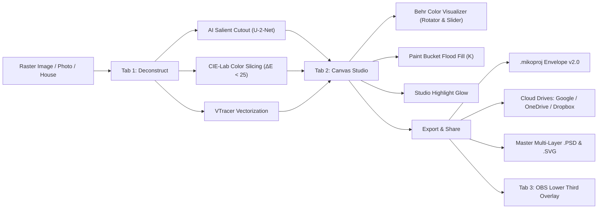

# Miko Studio Slicer

**Miko Studio Slicer** is an offline-first, professional desktop graphic workstation that decomposes flat raster graphics, generative AI concepts, architectural elevations, and brand artboards into editable, multi-layer vector and production assets.

Equipped with Bézier vector path extraction, multi-color OCR typography reconstruction, perceptual CIE-Lab color slicing, an integrated SMPTE broadcast lower-third engine, a Behr-style architectural color visualizer, and seamless cloud drive sharing, Miko Studio Slicer bridges the gap between flattened concept art and structured Adobe Photoshop/Illustrator files.

---

## What's New in Version 2.0

### 1. Desktop Application Menu Bar
A desktop-grade navigation bar featuring cascading menus with keyboard shortcut badges:
- **File:** Open Image (`Ctrl+I`), Open Project (`Ctrl+O`), Save Project (`Ctrl+S`), Cloud Drives & Share (`Ctrl+Shift+S`), Export Master `.PSD` (`Ctrl+E`), Export Vector `.SVG`, Export PNG Slices (`.ZIP`), Download 1080p PNG, Export OBS HTML Overlay.
- **Edit:** Undo (`Ctrl+Z`), Redo (`Ctrl+Y`), Cut (`Ctrl+X`), Copy (`Ctrl+C`), Paste (`Ctrl+V`), Delete, Select All (`Ctrl+A`), Group Selected (`Ctrl+G`), Ungroup (`Ctrl+Shift+G`), Group by Color.
- **View:** 1. Pull & Deconstruct (`1`), 2. Photoshop Canvas (`2`), 3. Lower Third Studio (`3`), Fit Artwork to Screen (`F`), Reset Viewport 1:1 (`0`).
- **Tools:** Pointer / Select (`V`), Lasso Select (`L`), Magic Path Eraser (`E`), Pan Hand (`H` / `Space`), Paint Bucket Tool (`K`), Freehand Draw Brush (`B`), Add Text Layer (`T`), Eyedropper Sampler (`I`), AI Region Extraction (`X`), Behr Color Visualizer (`C`).
- **Help:** Comprehensive Interactive How-To Guides (`F1` / `?`), Keyboard Shortcuts Cheatsheet (`/`), Cloud Drive Guide, Behr Color Visualizer Walkthrough.

### 2. High-Fidelity Project Saving & Cloud Storage Hub
- **Envelope Schema v2.0 (`.mikoproj`):** Projects are bundled into a verified JSON package containing canvas artboard dimensions, background color, brand color swatches, layer lock states, layer stacking order, and serialization metadata for 100% data fidelity when reloading.
- **Direct Device Share:** Utilizes the native W3C Web Share API to send projects or artwork directly through Windows Share, macOS AirDrop, Quick Share, or team chat applications.
- **Google Drive, Microsoft OneDrive & Dropbox Integration:** 1-click cloud export packages your verified `.mikoproj` file and launches your chosen cloud storage drive for friction-free drag-and-drop backup and cross-device sync.
- **Developer JSON Handoff:** Instantly copy formatted project envelopes to clipboard.

### 3. Paint Bucket Flood Fill Tool (`K`)
- Point-and-click flood fill tool designed for instant vector recoloring.
- Works seamlessly on standard shapes, text layers, vector paths, and deep sub-elements within complex grouped artwork without breaking group hierarchy.
- Directly synchronized with the active swatch, color inspector, and Behr designer palette.

### 4. Studio Highlight & Neon Glow Engine
- Add custom illumination, outline glow, or neon lighting to any selected cutout or layer.
- Controllable glow color picker, blur radius slider (0px to 50px), and instant two-way inspector synchronization.
- Renders in real time and exports into master layered `.PSD` and `.SVG` artboards.

### 5. Behr / Home Depot-Style Color Visualizer
Inspired by Home Depot ProjectColor and architectural paint visualizers, you can select items on your canvas and audition designer themes:
- **Curated Designer Themes:**
  - *Behr Architectural Neutrals:* Swiss Coffee (`#F1EFEA`), Blank Canvas (`#F6F4EB`), Cracked Pepper (`#3E4042`), Whisper White (`#F2F1ED`), Breezeway (`#D2DBD4`), Silver Drop (`#D5D5CE`).
  - *Modern Coastal & Navy:* Adirondack Blue (`#6B8E9B`), Deep Breath (`#3A5666`), Ultra Pure White (`#FFFFFF`), Sand Dance (`#C7B99D`), Coastal Sunrise (`#E4D8C8`), Ocean Boulevard (`#4A7C89`).
  - *Warm Terracotta & Clay:* Terra Cotta Urn (`#C36F52`), Canyon Dusk (`#9C6A5A`), Spanish Sand (`#DECDBB`), Roasted Corn (`#E8A752`), Spiced Mustard (`#B58742`), Autumn Red (`#933E31`).
  - *Mid-Century Modern Slate:* Battleship Gray (`#8A9096`), Blueprint (`#416788`), Orange Flambé (`#DE532C`), Graphic Charcoal (`#3A3B3C`), Celery (`#C6CBB3`), Goldenrod (`#DB9E36`).
  - *Nordic Pine & Sage:* Jojoba (`#89937E`), Nature's Gift (`#99A293`), Dark Evergreen (`#2E4437`), Natural Almond (`#E7DFC9`), Mineral (`#697A7C`), Spruce Mist (`#586E65`).
  - *Vibrant Studio Accents:* Cyber Yellow (`#FDE047`), Electric Cyan (`#06B6D4`), Neon Amber (`#F59E0B`), Hot Fuchsia (`#EC4899`), Electric Violet (`#8B5CF6`), Matrix Emerald (`#10B981`).
- **Interactive Palette Swatches:** One-click swatch strip recolors the active canvas selection and configures the Paint Bucket tool.
- **Continuous Hue Shift Slider (0° to 360°):** Real-time HSL color rotation math that dynamically shifts the temperature and hue spectrum of the entire palette and canvas selection simultaneously.
- **Color Cycling (`C`):** Instant hotkey to step through each shade in the active palette to audition finishes in seconds.

---

## Keyboard Shortcuts Cheatsheet

| Shortcut | Context | Action |
| :--- | :--- | :--- |
| `V` | Canvas | Pointer / Select Tool (click, Shift+click, marquee box) |
| `L` | Canvas | Freehand Lasso Loop Selection Tool |
| `E` | Canvas | Magic Cleanup Eraser Tool (target preview inside groups) |
| `K` | Canvas | Paint Bucket Flood Fill Tool |
| `H` / `Space + Drag` | Canvas | Pan Viewport (Hand Tool) |
| `B` | Canvas | Freehand Draw Brush Toggle |
| `T` | Canvas | Insert Live Editable Text Layer |
| `I` | Canvas | Eyedropper Color Sampler Tool |
| `X` | Canvas | AI Salient Region Extraction |
| `C` | Canvas | Cycle Active Behr Paint Color |
| `Ctrl + S` | Global | Save Project File (`.mikoproj` Envelope v2.0) |
| `Ctrl + Shift + S` | Global | Open Cloud Storage & Direct Share Hub |
| `Ctrl + O` | Global | Open Project File (`.mikoproj` / `.json`) |
| `Ctrl + E` | Global | Export Vector `.SVG` / PSD |
| `Ctrl + C` / `Ctrl + V` | Canvas | Copy / Paste active selection with visual offset |
| `Ctrl + X` / `Ctrl + D` | Canvas | Cut / Duplicate layer in place |
| `Ctrl + Z` / `Ctrl + Y` | Canvas | 40-State Undo / Redo History |
| `Ctrl + A` | Canvas | Select All Unlocked Canvas Layers |
| `Ctrl + G` / `Ctrl + Shift + G` | Canvas | Group Selected / Ungroup Group |
| `Ctrl + ]` / `Ctrl + [` | Canvas | Bring Forward / Send Backward |
| `Ctrl + Shift + ]` / `Ctrl + Shift + [` | Canvas | Bring to Front / Send to Back |
| `Delete` / `Backspace` | Canvas | Delete Active Selection |
| `Arrow Keys` | Canvas | Nudge 1px (`Shift + Arrow` for 10px) |
| `1` | Global | Switch to Pull & Deconstruct Tab |
| `2` | Global | Switch to Photoshop Canvas Studio Tab |
| `3` | Global | Switch to Lower Third Studio Tab |
| `0` | Canvas | Reset Canvas Viewport to 1:1 Scale |
| `F` | Canvas | Fit Artwork to Screen View |
| `F1` / `?` | Global | Open Interactive Help & Master Walkthrough Modal |
| `/` | Global | Open Keyboard Shortcuts Cheatsheet Modal |
| `Esc` | Global | Deselect, Dismiss Modals & Close Menus |

---

## Core Pipeline



---

## Installation & Quick Start

### Standard Host Installation (Windows 10/11)
1. Clone the repository:
   ```bash
   git clone https://github.com/phantomsound/mikostudioslicer.git
   cd mikostudioslicer
   ```
2. Install Python dependencies:
   ```bash
   pip install -r requirements.txt
   ```
3. Run the workstation server:
   ```bash
   python server.py --launch
   ```
4. Access the web interface at `http://127.0.0.1:8088`.

### Portable USB Flash Drive Execution
1. Copy the repository contents onto your USB drive (e.g. `E:\MikostudioSlicer\`).
2. Download the official **Windows embeddable package (64-bit)** from [python.org](https://www.python.org/downloads/windows/) and extract it into `python_portable\`.
3. Copy installed site-packages into `python_portable\Lib\site-packages\`.
4. Double-click `run_portable.bat`. The server dynamically locates an available port (8088–8138) and opens your default browser automatically.

---

## Automated Test Suites

The repository contains automated headless verification suites using Microsoft Edge and Chrome DevTools Protocol (CDP):
- `scratch/browser_button_validator.py`: Discovers and live-clicks all 150 toolbar, modal, and inspector buttons.
- `scratch/test_workflows.py`: Validates 14 end-to-end user workflows (alignment, grouping, gradient engine, OBS broadcast generation, PSD compilation).
- `scratch/test_new_features.py`: Confirms modal navigation, `.mikoproj` envelope integrity, Behr color slider/cycling, studio glow, and paint bucket fill.

---

## License

Distributed under the [MIT License](LICENSE).
